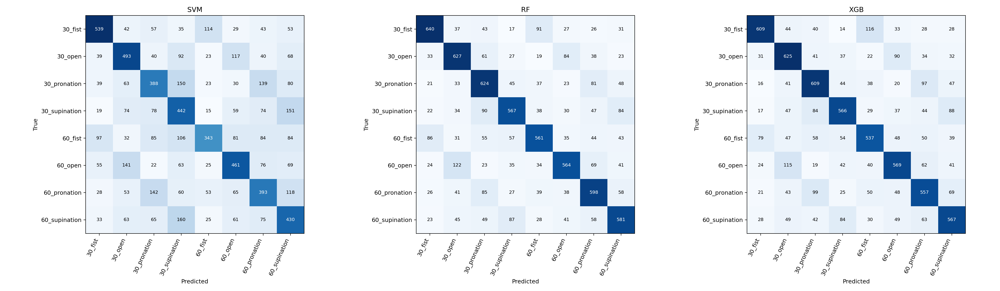
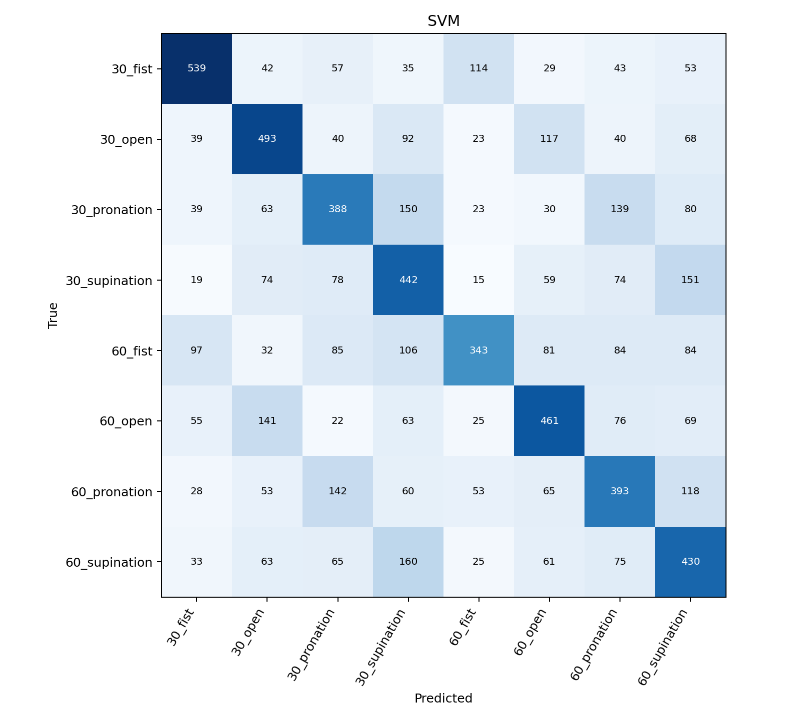
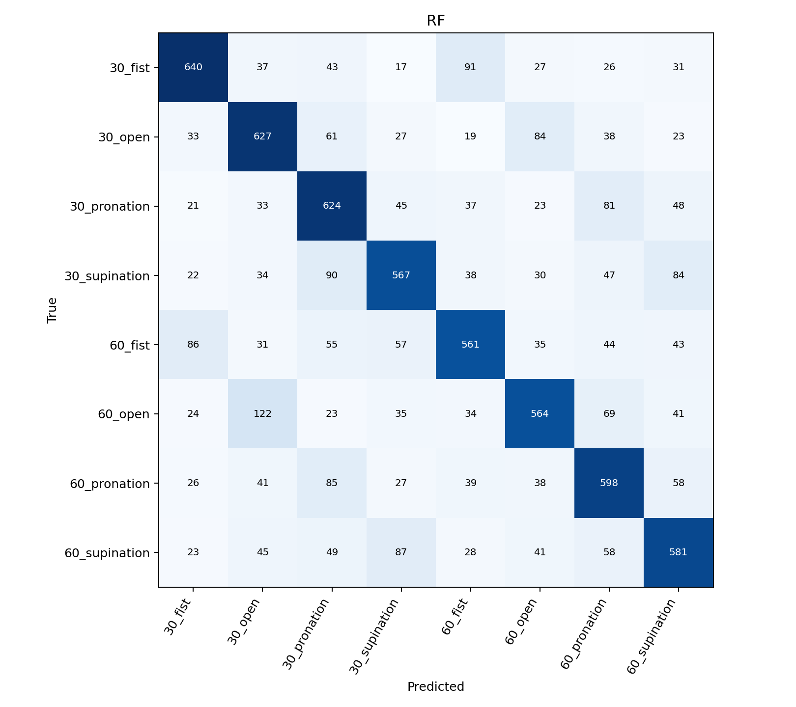
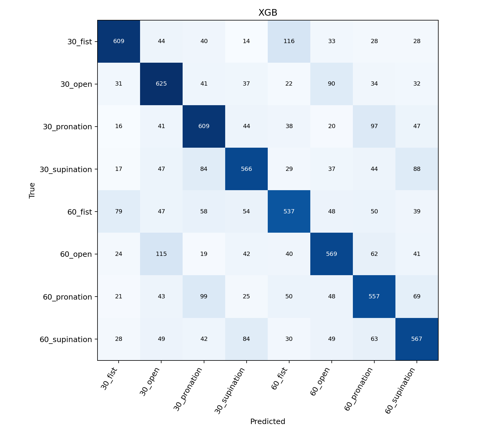

# sEMG 기반 손동작 및 팔꿈치 각도 분류
이동현 21113718 · 딥러닝프로그래밍 Step 2 실험 보고서


## 1. 코드 설명
본 실험은 5채널 sEMG를 이용하여 4개 손동작과 2개 팔꿈치 각도의 조합으로 구성된 8개 클래스를 분류하였다.
원본 CSV 64개에서 mark를 기준으로 파일당 30개의 시행 후보를 구분하였다.
mark는 5초 시행 후보의 기준점으로 사용하였으나, 실제 동작 시작 시점과의 관계는 확인되지 않았다.
각 기준점 이후 1.5초부터 2초간의 구간을 분석 대상으로 설정하였으며, 이는 본 실험에서 채택한 가정이다.
제공된 bandpass 신호에 강의에서 제시된 노치60Hz Q30 및 20~450Hz 4차 필터를 추가 적용하였다.
200ms 윈도우를 100ms 간격으로 배치하여 시행당 19개 윈도우에서 RMS/MAV/WL/ZC/SSC를 산출하였다.
각 윈도우에서 추출한 25개 특징을 개별 입력 표본으로 사용하였다.

전체 1,920개 시행 후보를 시행 단위로 80:20 분할하였다.
학습 집합은 1,536개 시행/29,184개 윈도우, 테스트 집합은 384개 시행/7,296개 윈도우로 구성하였다.
동일 시행에 속하는 윈도우의 집합 간 중복을 차단하였으나, 동일 참가자 및 기록 파일의 서로 다른 시행은 양쪽 집합에 포함될 수 있다.
표준화는 각 학습 집합에서만 적합하였으며, 5-fold 교차검증은 전체 시행을 대상으로 별도로 수행하였다.
따라서 CV와 hold-out은 서로 독립된 외부 평가에 해당하지 않는다. 평가 지표는 Accuracy와 macro Precision/Recall/F1을 사용하였다.

### 실행 방법
```bash
pip install -r requirements.txt
python main.py
```
실행 시 결과 파일과 함께 README.md 및 report.md의 초안이 재생성되므로, 최종 문서는 재실행 전에 별도로 보관해야 한다.

데이터는 고정 revision에서 자동으로 내려받으며, CPU 환경에서 실행 가능하다.
원 데이터: https://github.com/TestUser-alt-dev/sEMG-Hand-Gesture-Elbow-Angle-Dataset
데이터 revision: cb64ded658b83ae97e6388dd373efad0e97bc47c
데이터셋 인용 논문 DOI: 10.1007/s13534-026-00607-7

| 파일 | 역할 |
| --- | --- |
| main.py | 데이터 확보, 특징 생성, 학습, hold-out, CV, 검정, 결과 저장 |
| requirements.txt | 실행 시 사용한 주요 패키지 버전 |
| results/config.json | 전처리, 분할 및 분석 가정 |
| results/*manifest.csv | hold-out 및 CV의 시행별 배정 |
| results/holdout_predictions.csv | 재확인 가능한 실제/예측 라벨 |
| figures/ | 혼동행렬과 이벤트 정렬 그림 |
| report.md 및 report.pdf | 7개 항목으로 구성된 실험 보고서 |

## 2. 모델 성능 비교
hold-out 평가 결과를 다음 표에 제시하였다. 지표의 단위는 %이다.

| Model | Accuracy | Precision | Recall | F1-score |
| --- | --- | --- | --- | --- |
| SVM | 47.82 | 48.57 | 47.82 | 47.89 |
| RF | 65.27 | 65.44 | 65.27 | 65.28 |
| XGB | 63.58 | 63.77 | 63.58 | 63.6 |

### 5-fold 교차검증
표준편차는 ddof=0으로 산출하였으며, 폴드별 결과는 results/cv_folds.csv에 기록하였다.

| Model | CV Accuracy mean ± std (%) |
| --- | --- |
| SVM | 47.57 ± 0.35 |
| RF | 64.54 ± 0.72 |
| XGB | 62.86 ± 0.83 |

5-fold 교차검증에서 평균 정확도가 가장 높은 모델은 **RF**였다.
단일 분할을 이용한 hold-out과 다섯 폴드로 구성된 교차검증(CV) 모두 **RF → XGB → SVM** 순의 성능을 보였다.
hold-out에서 RF의 정확도와 F1-score는 각각 65.27%, 65.28%로 가장 높았다.
CV 평균 정확도에서도 RF는 XGB보다 **1.68%p**, SVM보다 **16.97%p** 높았으며, 개별 폴드에서도 동일한 순위가 유지되었다.
%p는 백분율 간의 차이를 의미하며, 65%와 60%의 차이는 5%p에 해당한다.

표의 ± 뒤에 제시한 표준편차는 폴드 간 정확도의 변동을 나타낸다.
SVM은 ±0.35%p로 변동이 가장 작았으나 평균 정확도 역시 가장 낮았다.
낮은 변동만으로 분류 성능의 우수성을 판단하기는 어렵다.
RF와 XGB의 표준편차는 각각 0.72%p, 0.83%p로, 평가한 다섯 폴드에서 RF의 변동이 상대적으로 작았다.
이 값은 해당 분할에서 관찰된 변동이며, 새로운 참가자 전체에 대한 성능 범위를 의미하지 않는다.

비교 대상 논문의 보고값은 RF 96.72±0.58%, XGB 96.15±0.56%, SVM 95.83±0.79%로 본 실험 결과보다 높았다.
본 실험에서는 마커를 기준으로 시행 후보를 구분하고, 각 시행의 2초 구간에서 추출한 19개 윈도우를 개별 평가하였다.
또한 사전 필터링된 신호에 추가 필터를 적용하였다.
표본 구성, 신호 처리, 분할 및 평가 단위가 비교 논문과 동일한지 확인되지 않았으므로, 성능 차이 전체를 모델 자체의 특성에 귀속하기는 어렵다.
직접적인 비교를 위해서는 평가 단위와 분할 조건을 일치시킨 추가 실험이 필요하다.

### 통계 검정

<table>
  <thead>
    <tr>
      <th>A</th><th>B</th><th>평균 차이<br>A − B (%p)</th><th>t값</th><th>p_raw</th><th>p_holm</th><th>판단</th>
    </tr>
  </thead>
  <tbody>
    <tr><td>SVM</td><td>RF</td><td>−16.9682</td><td>−50.6468</td><td>9.10 × 10<sup>−7</sup></td><td>2.73 × 10<sup>−6</sup></td><td>RF가 높음 · 차이 검출</td></tr>
    <tr><td>SVM</td><td>XGB</td><td>−15.2878</td><td>−46.8482</td><td>1.24 × 10<sup>−6</sup></td><td>2.73 × 10<sup>−6</sup></td><td>XGB가 높음 · 차이 검출</td></tr>
    <tr><td>RF</td><td>XGB</td><td>1.6804</td><td>10.8254</td><td>0.000413</td><td>0.000413</td><td>RF가 높음 · 차이 검출</td></tr>
    <tr><td colspan="7"><strong>검정 방법:</strong> 동일 폴드에서 산출한 두 모델의 정확도를 대응시켜 양측 대응표본 t검정을 수행하였으며, 유의수준은 0.05로 설정하였다.</td></tr>
    <tr><td colspan="7"><strong>p값 구분:</strong> p_raw는 보정 전 p값, p_holm은 세 쌍의 비교에 따른 다중검정 오류를 줄이기 위해 Holm 방법으로 보정한 p값이며, 세 쌍 모두 두 값이 0.05 미만이었다.</td></tr>
    <tr><td colspan="7"><strong>SVM–RF:</strong> RF의 CV 평균 정확도는 SVM보다 16.97%p 높았으며, 보정 전 p값이 약 0.000000910으로 0.05 미만이므로 해당 검정에서 유의한 차이가 관찰되었다.</td></tr>
    <tr><td colspan="7"><strong>SVM–XGB:</strong> XGB의 CV 평균 정확도는 SVM보다 15.29%p 높았으며, 보정 전 p값이 약 0.00000124로 0.05 미만이므로 해당 검정에서 유의한 차이가 관찰되었다.</td></tr>
    <tr><td colspan="7"><strong>RF–XGB:</strong> RF의 CV 평균 정확도는 XGB보다 1.68%p 높았으며, 보정 전 p값이 약 0.000413으로 0.05 미만이므로 유의한 차이가 관찰되었으나 모델 선택에는 성능 차이의 크기와 추론 시간을 함께 고려해야 한다.</td></tr>
    <tr><td colspan="7"><strong>해석의 한계:</strong> 모델별 비교값은 다섯 개이며 폴드 간 학습 집합이 중복되어 독립된 반복 실험으로 간주하기 어려우므로, 작은 p값만으로 새로운 참가자에 대한 동일한 성능 차이를 보장할 수는 없다.</td></tr>
    <tr><td colspan="7"><strong>차이 미검출의 의미:</strong> p값이 0.05 이상인 경우에는 해당 자료에서 유의한 차이가 검출되지 않은 것으로 해석하며, 두 모델의 성능이 동등하다는 근거로 간주하지 않는다.</td></tr>
  </tbody>
</table>

### 계산 비용

| Model | Train_seconds | Inference_ms_per_window |
| --- | --- | --- |
| SVM | 59.5451 | 3.0172 |
| RF | 21.971 | 34.9809 |
| XGB | 24.0205 | 4.1868 |

학습 시간은 scaler+fit, 추론 시간은 사전 계산한 25D 특징 한 개에 대한 scaler+predict를 기준으로 측정하였다.
추론 시간은 예열 10회 후 100회 측정한 평균값이며, 신호 취득, 필터링, 특징 추출 및 데이터 다운로드 시간은 제외하였다.
측정 환경은 results/environment.json에 기록하였다. Colab에서의 측정값은 장치와 실행 조건에 따라 달라질 수 있다.

## 3. Confusion Matrix 분석

행은 실제 클래스, 열은 예측 클래스를 나타낸다. 세부 수치는 error_pairs.csv, class_recall.csv, error_types.csv에 기록하였다.

클래스명의 숫자는 팔꿈치 각도를 나타낸다. 예를 들어 `60_fist`는 팔꿈치 60°에서 주먹을 쥔 상태에 해당한다.
`open`은 손 펴기, `pronation`은 손바닥을 아래로 향하게 하는 회내, `supination`은 손바닥을 위로 향하게 하는 회외를 의미한다.
클래스별 정답 비율은 해당 클래스의 전체 윈도우 중 올바르게 분류된 비율인 재현율로 정의하였다.

### SVM

- 가장 잘 분류된 클래스(재현율 기준, 공동 포함): 30_fist
- 재현율이 가장 낮은 클래스(공동 포함): 60_fist
- 주요 방향별 오류 쌍:

| Model | true | predicted | count | type |
| --- | --- | --- | --- | --- |
| SVM | 60_supination | 30_supination | 160 | angle_only |
| SVM | 30_supination | 60_supination | 151 | angle_only |
| SVM | 30_pronation | 30_supination | 150 | gesture_only |
| SVM | 60_pronation | 30_pronation | 142 | angle_only |
| SVM | 60_open | 30_open | 141 | angle_only |

SVM에서는 **각도 단독 오류 1,061개, 동작 단독 오류 1,544개, 각도·동작 동시 오류 1,202개**가 관찰되었다.
동작 단독 오류는 각도 단독 오류보다 **483개** 많았다.
개별 방향별 오류 중에서는 동일 동작의 각도 혼동에 해당하는 `60_supination → 30_supination`이 160개로 가장 많았다.
이는 최대 빈도의 개별 오류 쌍과 전체 오류 유형의 분포를 구분하여 해석할 필요가 있음을 나타낸다.

클래스별 재현율은 `30_fist`가 59.10%로 가장 높았으며, `60_fist`가 37.61%로 가장 낮았다.
동일한 주먹 동작에서도 팔꿈치 각도에 따라 분류 성능의 차이가 관찰되었다.
이러한 차이에는 사용한 25개 특징의 동작 간 구분 정보 부족이나 해당 특징에 대한 SVM 설정의 부적합이 관여하였을 가능성이 있다.
원인 검증을 위해서는 주요 혼동 클래스의 특징 분포를 비교하고, 테스트 집합을 유지한 상태에서 학습 집합 내부의 검증을 통해 SVM의 C와 gamma를 조정할 필요가 있다.
혼동행렬만으로 특정 근육의 활성 차이를 원인으로 확정할 수는 없다.

### RF

- 가장 잘 분류된 클래스(재현율 기준, 공동 포함): 30_fist
- 재현율이 가장 낮은 클래스(공동 포함): 60_fist
- 주요 방향별 오류 쌍:

| Model | true | predicted | count | type |
| --- | --- | --- | --- | --- |
| RF | 60_open | 30_open | 122 | angle_only |
| RF | 30_fist | 60_fist | 91 | angle_only |
| RF | 30_supination | 30_pronation | 90 | gesture_only |
| RF | 60_supination | 30_supination | 87 | angle_only |
| RF | 60_fist | 30_fist | 86 | angle_only |

RF에서는 **각도 단독 오류 720개, 동작 단독 오류 991개, 각도·동작 동시 오류 823개**가 관찰되었다.
동작 단독 오류는 각도 단독 오류보다 **271개** 많았으며, 전체 오류는 2,534개로 세 모델 중 가장 적었다.
최대 빈도의 방향별 오류는 `60_open → 30_open`으로 122개였다.
전체 오류에서는 동작 혼동의 비중이 더 컸으나, 손을 편 상태의 각도 구분에서도 개선이 필요한 것으로 나타났다.

클래스별 재현율은 `30_fist`가 70.18%로 가장 높았으며, `60_fist`가 61.51%로 가장 낮았다.
평균 성능이 가장 높은 RF에서도 클래스 간 성능 차이는 존재하였다.
두 각도에서의 특징 분포 유사성 또는 일부 참가자에서의 구분 어려움이 가능한 원인으로 고려된다.
이를 검증하기 위해서는 `30_open`과 `60_open`의 특징 분포를 참가자별로 비교하고, 참가자별 오류 쌍을 집계하여 특정 참가자에 대한 오류 집중 여부를 분석할 필요가 있다.
해당 분석에 앞서 근육 특성이나 참가자 차이를 실제 원인으로 단정하기는 어렵다.

### XGB

- 가장 잘 분류된 클래스(재현율 기준, 공동 포함): 30_open
- 재현율이 가장 낮은 클래스(공동 포함): 60_fist
- 주요 방향별 오류 쌍:

| Model | true | predicted | count | type |
| --- | --- | --- | --- | --- |
| XGB | 30_fist | 60_fist | 116 | angle_only |
| XGB | 60_open | 30_open | 115 | angle_only |
| XGB | 60_pronation | 30_pronation | 99 | angle_only |
| XGB | 30_pronation | 60_pronation | 97 | angle_only |
| XGB | 30_open | 60_open | 90 | angle_only |

XGB에서는 **각도 단독 오류 768개, 동작 단독 오류 1,045개, 각도·동작 동시 오류 844개**가 관찰되었다.
동작 단독 오류는 각도 단독 오류보다 **277개** 많았다.
방향별 오류 빈도 상위 다섯 쌍은 모두 동일 동작의 각도 혼동에 해당하였으며, `30_fist → 60_fist`가 116개로 가장 많았다.
각도 오류는 일부 쌍에 집중된 반면, 여러 쌍에 분포한 동작 오류의 합계는 각도 오류의 합계보다 크게 나타났다.

클래스별 재현율은 `30_open`이 68.53%로 가장 높았으며, `60_fist`가 58.88%로 가장 낮았다.
현재 특징에 포함된 각도 구분 정보가 제한적이거나 트리 깊이와 학습 횟수 등의 설정이 해당 자료에 적합하지 않았을 가능성이 있다.
이를 검증하기 위해서는 주요 각도 혼동 쌍의 특징을 비교하고, 학습 집합 내부의 교차검증을 통해 설정 변화에 따른 성능을 평가할 필요가 있다.
본 결과만으로 XGB의 일반적인 성능이 RF보다 낮거나 해당 신호의 분류가 본질적으로 불가능하다고 결론 내릴 수는 없다.

### 추가 분석

| Model | window_accuracy | trial_vote_accuracy | tie_trials |
| --- | --- | --- | --- |
| SVM | 0.4782 | 0.7448 | 25 |
| RF | 0.6527 | 0.9714 | 3 |
| XGB | 0.6358 | 0.9531 | 5 |

윈도우 단위 정확도와 시행 단위 다수결 정확도를 비교하였다. 최다 득표 클래스 간 동률은 인코딩 순서에 따라 처리하였다.

동일 시행에서 산출한 19개 윈도우 예측 중 최빈 클래스를 해당 시행의 최종 예측으로 결정하였다.
일부 윈도우에서 오분류가 발생하더라도 정답 클래스가 최다 득표한 경우에는 해당 시행을 정분류로 집계하였다.
시행 단위 집계에 따라 정확도는 SVM **47.82% → 74.48%**, RF **65.27% → 97.14%**, XGB **63.58% → 95.31%**로 증가하였다.
이는 동일 동작 구간 내 예측의 집계가 시행 단위 분류 성능을 개선할 수 있음을 시사한다.

윈도우 평가는 **7,296개**, 시행 평가는 **384개**를 대상으로 하므로 두 결과의 평가 단위는 서로 다르다.
RF의 97.14%는 시행 단위 정확도이며, 단일 윈도우의 정확도나 새로운 참가자에 대한 정확도로 해석할 수 없다.
또한 19개 윈도우는 중첩되므로 독립된 19회의 예측으로 간주하기 어렵고, 다수결에는 분석 대상인 2초 구간 전체가 요구된다.
따라서 단일 윈도우의 추론 시간만으로 시행 단위 판단의 지연 시간을 설명하기는 어렵다.
최다 득표 클래스 간 동률이 발생한 시행은 SVM 25개, RF 3개, XGB 5개였으며, 동률 시 인코딩 번호가 작은 클래스를 선택하는 규칙이 결과에 영향을 미칠 수 있다.

## 4. 최종 결과

- **RF는 세 모델 중 가장 높은 분류 성능을 보였다.** hold-out 정확도 65.27%, F1-score 65.28%, CV 평균 정확도 64.54%로 가장 높은 값을 기록하였다.
- **SVM은 세 모델 중 가장 낮은 분류 성능을 보였다.** hold-out 정확도는 47.82%, CV 평균 정확도는 47.57%였으며, 이는 본 실험의 특징 구성과 설정에서 얻은 결과이다.
- **주요 오류는 동작 혼동과 일부 각도 쌍의 혼동으로 나타났다.** 세 모델 모두 전체 집계에서 동작 단독 오류가 각도 단독 오류보다 많았으며, 클래스별 재현율은 공통으로 `60_fist`에서 가장 낮았다.
- **정확도를 우선하는 조건에서는 RF가 적합한 선택으로 판단된다.** 학습 시간은 RF 21.97초, XGB 24.02초, SVM 59.55초로 RF가 가장 짧았다.
- **단일 예측의 처리 시간을 고려하는 조건에서는 XGB도 대안이 될 수 있다.** RF와 XGB의 hold-out 정확도 차이는 1.69%p였으나, 특징 한 개의 추론 시간은 RF 34.98ms, XGB 4.19ms였다. SVM은 3.02ms로 가장 짧았으나 정확도가 크게 낮았다. 해당 시간은 본 실행 환경의 측정값이며, 실제 적용 장치에서의 재측정이 필요하다.

본 실험은 **모델의 종류나 단일 최고 점수만으로는 선택 근거가 충분하지 않음**을 보여준다.
모델 선택에는 평균 성능, 폴드 간 변동, 클래스별 오류 및 추론 시간을 함께 고려할 필요가 있다.
동일한 예측 결과도 윈도우 단위와 시행 단위에서 서로 다른 정확도를 나타내므로, 평가 단위와 정답 집계 기준을 명시해야 한다.
새로운 참가자에 대한 성능 유지 여부, 마커 이후 분석 구간 변화의 영향, 추가 필터의 효과는 본 실험에서 확인되지 않았다.
후속 연구에서는 참가자 한 명의 전체 자료를 평가 집합으로 분리하는 LOSO 검증, 분석 시작점 비교 및 추가 필터 적용 여부 비교를 통해 이를 검토할 수 있다.

### 한계
1. Trial-wise 분할에서는 동일 참가자 및 기록 파일의 서로 다른 시행이 학습과 평가에 함께 포함될 수 있으므로, 새로운 참가자에 대한 일반화 성능은 LOSO 등의 별도 검증이 필요하다.
2. mark 기준 분석 시작점 +1.5초는 분석상의 가정이며, 실제 근활성 구간과의 정렬은 확인되지 않았다.
3. 제공 데이터는 이미 필터링된 신호이며 본 실험에서는 추가 필터를 적용하였으므로, 비교 논문과 동일한 신호 처리 절차로 간주하기 어렵다.
4. 중첩된 19개 윈도우는 독립된 19회 실험에 해당하지 않으며, 윈도우 단위 정확도와 시행 단위 정확도는 구분하여 해석해야 한다.
5. 5-fold p값은 적은 표본 수와 폴드 간 의존성의 영향을 받으며, 유의한 차이가 검출되지 않았다는 사실은 동등성의 근거가 되지 않는다.
6. Colab에서 측정한 계산 비용은 특정 실행 환경의 결과이며, 임베디드 실시간 시스템의 전체 지연 시간을 의미하지 않는다.

## 재현 정보
분할/모델 seed=42, CV=5-fold stratified로 설정하였다. 주요 설정은 results/config.json 및 model_parameters.json,
환경 버전은 results/environment.json, 분할 목록은 manifest 파일에 기록하였다.
